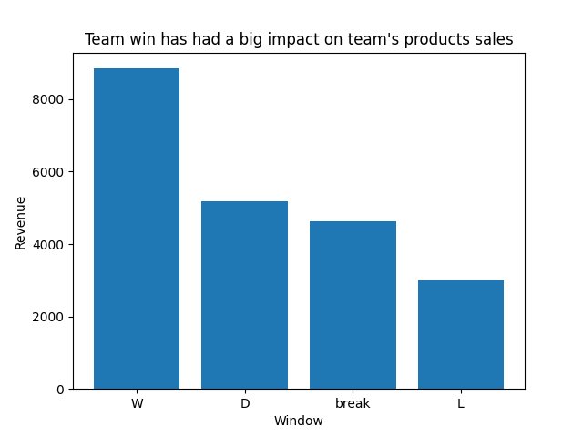

# ETL project: Does Winning Sell Jerseys?

In this project, my aim was to make a pipeline, that can fetch data from API, make some transformations on the raw data and finally generate some insights based on the transformed data.
The data i worked with came from four sources:

- orders: json file, from an API (https://github.com/Cvijan/nss-api)
- products: CSV file from store system
- teams: league CSV file that contains all teams competing
- matches: parquet file from league platform

Main part was a pipeline creation that involved data fetching from an API, saving data as raw files, extracting them to the dataframes and then manipulating data through data cleaning, data deduplication, data validation and at the end data transformation.  
We succeeded to provide useful data that can be used in analytical purposes, in order to find a solution for the main question, as the title says. But, a lot of manipulation was needed in the form of various concatenations, aggregations, joining and restructuring so we can find a target insight: Does winning sell jerseys. And we got the positive answer.  

We have analyzed the revenue during the period from the day of the game until three days afterwards and the insights we gained tells us that a match win is a big revenue generator and have a big influence on the team's products sales.

